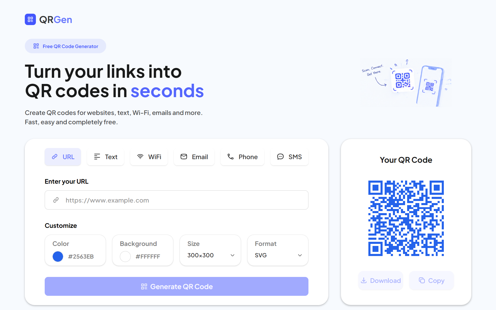

# 📱 QRGen

<p align="center">
  
  
  
</p>

A simple and modern **QR Code Generator** that lets you create QR codes for URLs, text, WiFi networks, emails, phone numbers, and SMS messages.
Customize the colors, size, and format of your QR code, then download it or copy it straight to your clipboard.
Fast, clean, and free to use, with no sign-up required.
<br><br>

<p align="center">
    
</p>

## 🖥️ Demo

<br>

🌐 **Try it now:** [https://qr-generator-do8a.vercel.app/](https://qr-generator-do8a.vercel.app/)

---

## Table of Contents 📑

- [How to use 📖](#how-to-use-)
- [Features ✨](#features-)
- [Technologies Used 🛠️](#technologies-used)
- [API 🌐](#api-)
- [Installation & Setup 📥](#installation-&-setup)
- [Future Improvements 🔮](#future-improvements-)
- [Author 👤](#author-)
- [License 📄](#license-)

---

## How to use 📖

1. Open the webpage in your **browser**.
2. Choose the **type** of QR code you want (URL, Text, WiFi, Email, Phone, or SMS).
3. Fill in the **required fields** for the selected type.
4. Customize the **QR color**, **background color**, **size**, and **format** (PNG or SVG).
5. Check the **live preview** of your QR code.
6. Click **Download** to save the QR code, or **Copy** to copy it to your clipboard.

---

## Features ✨

- 🔗 Generate QR codes for **URL, Text, WiFi, Email, Phone, and SMS**
- 🎨 Customize the **QR code color** and **background color**
- 📏 Choose the **size** of the QR code
- 🖼️ Export as **PNG** or **SVG**
- 💾 **Download** the generated QR code
- 📋 **Copy** the result to your clipboard
- 📱 Fully **responsive design** for desktop and mobile devices

### Supported QR code types

| Type  | What it does                                               |
| ----- | ---------------------------------------------------------- |
| URL   | Opens a website when scanned                               |
| Text  | Displays any plain text                                    |
| WiFi  | Connects to a WiFi network (SSID, password, security)      |
| Email | Opens an email draft with address, subject, and message    |
| Phone | Starts a phone call to the given number                    |
| SMS   | Opens a text message with a number and a prefilled message |

<h2 id="technologies-used">Technologies Used 🛠️</h2>

| Technology      | Purpose                                  |
| --------------- | ---------------------------------------- |
| ⚛️ React.js     | Component-based UI and state management  |
| 🔷 TypeScript   | Type safety on both frontend and backend |
| ⚡ Vite         | Fast development server and build tool   |
| 🎨 Tailwind CSS | Styling and responsive layout            |
| 🟢 Node.js      | Backend API (vanilla, no framework)      |
| ⚡ Vercel       | Frontend and backend hosting             |

---

## API 🌐

The backend is a lightweight **vanilla Node.js API written in TypeScript**. It receives the QR code data and options from the frontend and returns the generated QR code in the selected format (PNG or SVG).

Both the frontend and the backend are deployed on **Vercel** as separate projects.

<h2 id="installation-&-setup">Installation & Setup 📥</h2>

1. **Install Node.js**
   <br>

   Make sure **Node.js** is installed on your system. You can download it from [https://nodejs.org/](https://nodejs.org/).

2. **Clone the repository**:

```bash
git clone git@github.com:CamdzicAlden/QRGen.git
```

3. **Navigate to the backend folder**:

```bash
cd backend
```

4. **Install backend dependencies**:

```bash
npm install
```

5. **Start the backend server**:

```bash
npm run dev
```

6. **Open a new terminal and navigate to the frontend folder**:

```bash
cd frontend
```

7. **Install frontend dependencies**:

```bash
npm install
```

8. **Configure local development**:

Set the API URL in the frontend to your local backend address (for example `http://localhost:5000`) and make sure the CORS origin in the backend allows `http://localhost:5173`.

9. **Start the frontend development server**:

```bash
npm run dev
```

10. **Open the provided local URL** (usually http://localhost:5173) and start generating QR codes!

---

## Future Improvements 🔮

- Add support for **more QR code types** (vCard, calendar events, etc.)
- Add the option to **embed a logo** in the center of the QR code
- Add **error correction level** selection
- Save **recent QR codes** locally in the browser

---

## Author 👤

**Alden Čamdžić**

---

## License 📄

<i>This project is open-source and free to use for educational purposes.</i>
